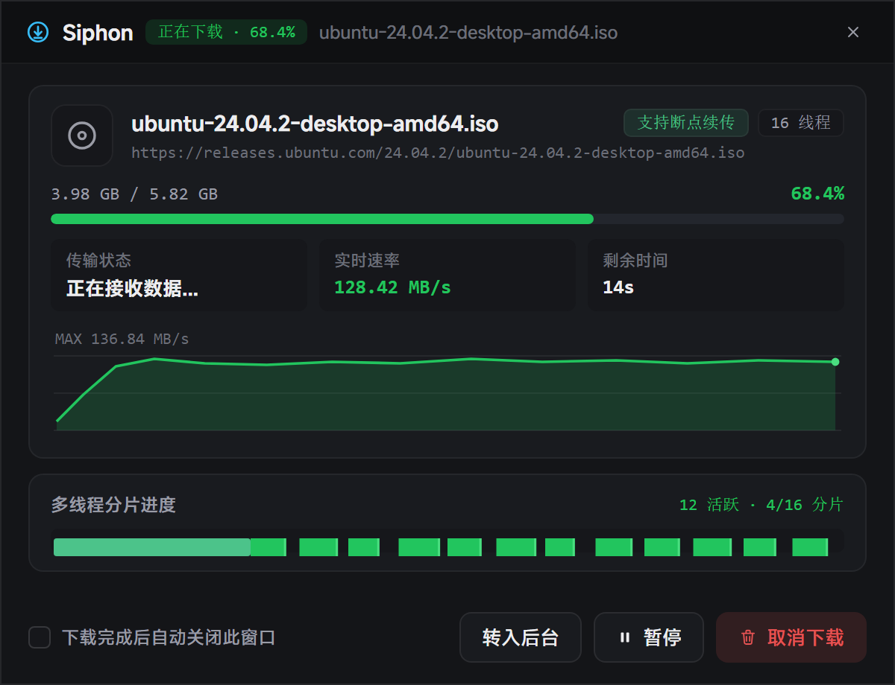

  

<h1 align="center">Siphon Downloader</h1>

  <strong>纯 Rust 构建的 Windows 11 多协议多线程下载器</strong>

  
  
  
  

---

## 界面预览

---

## 核心功能

- **多协议纯 Rust 引擎**：HTTP/HTTPS 真多线程动态借片（断点续传、过期直链替换、哈希校验）、HLS（`.m3u8` AES-128 解密合并）、BitTorrent / 磁力链接与 eD2k 电驴（MD4 分块校验、`server.met` 订阅）。
- **BitTorrent 与做种管理**：纯 Rust **MSE/PE（DH + RC4）协议加密**、IPv4+IPv6 双栈、自定义/订阅 Tracker 一键同步、实时端口可达性与 TUN 诊断、独立 BT 引擎与自动做种开关（支持分享率上限），以及专属 **「种子 / 做种」** 分类与右侧 Swarm 详情面板。
- **RSS 订阅与自动追更**：原生解析 RSS 2.0 / Atom 1.0，支持关键词与正则包含/排除过滤、后台定时轮询、跨重启去重与自动下载磁力/种子/直链。
- **高效任务管理**：任务筛选与排序栏（默认下载置顶 + 进度与请求时间排序）、双击直接以原生方式打开已完成文件，以及仅在唤起下载时出现的悬浮捕获窗、资源嗅探与子文件勾选窗。
- **浏览器扩展与自动化**：Chrome / Edge 扩展自动携带 Cookie / Referer 接管下载并在未启动时拉起客户端；内置定时调度、通配符批量导入、自动化分类规则与外部插件支持。
- **原生 Windows 11 体验**：深浅 Graphite 主题与 Mica 材质、自定义主色与数据目录、静默常驻托盘与应用内一键更新。

---

## 下载与安装

前往 [**GitHub Releases**](https://github.com/COMICFLY/siphon-downloader/releases) 下载：

- **`Siphon-Setup-0.9.0-x64.exe`**：Windows 安装包（内置浏览器扩展文件夹与 `.zip` 包）
- **`siphon-browser-extension-v0.9.0.zip`**：独立 Chrome / Edge 浏览器扩展压缩包

---

  Made by <a href="https://github.com/COMICFLY">COMICFLY</a> · <a href="LICENSE">MIT License</a>

