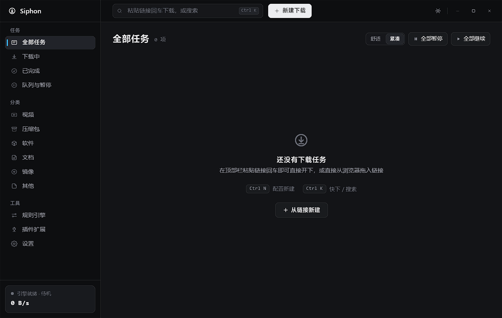

<p align="center">
  
</p>

<h1 align="center">Siphon Downloader</h1>

<p align="center">
  <strong>纯 Rust 构建的 Windows 11 高性能多协议多线程下载器</strong><br/>
  HTTP 动态二分借片 · HLS (.m3u8) 嗅探合并 · BitTorrent / 自定义 Tracker · eD2k 电驴 · 计划调度与批量队列
</p>

<p align="center">
  <a href="https://github.com/COMICFLY/siphon-downloader/releases"></a>
  
  
  <a href="LICENSE"></a>
</p>

---

## 界面预览

### 主界面（Graphite 深色主题 · MiSans 字体 · 系统原生文件图标）


### 独立悬浮下载详情弹窗（自定义数据主题色 · 60s 实时吞吐曲线 · 无缝分片进度条）


---

## 主要功能

### 1. 高性能纯 Rust 多协议下载引擎（HTTP / HLS / BitTorrent / eD2k）
- **HTTP/HTTPS 真多线程并发引擎**：基于独立 HTTP/1.1 TCP 并发连接与 `TCP_NODELAY`，避免 HTTP/2 单连接流控瓶颈，充分跑满千兆宽带（实测单任务峰值突破 `130 MB/s`）；内置**动态二分借片（Dynamic Work Stealing）**、**256 KB 写缓冲合并落盘**、SQLite 分片断点续传、过期直链无缝替换、分级令牌桶限速与 **SHA-256 / MD5 / BLAKE3** 哈希校验。
- **HLS（`.m3u8`）流媒体引擎**：原生纯 Rust 解析 Master / Media 播放列表（自动选择最高码率流），支持 **AES-128-CBC 分片实时解密**、并发分片拉取与断点续传、按序无损合并输出。
- **BitTorrent / Magnet 协议与独立「BT / Tracker」菜单**：基于纯 Rust `librqbit` 驱动，支持 `magnet:?` 磁力链接、`.torrent` 远端直链与本地 `.torrent` 种子文件拖拽/导入；独立 **BT / Tracker** 页面提供 DHT / LSD / UPnP / 监听端口 / 最大 Peer / 连接超时设置、**自定义 Tracker 批量增删与剪贴板导入**，以及**公共 Tracker 订阅源一键同步与启动自动刷新**。
- **eD2k 电驴协议与独立「eD2k 电驴」菜单**：原生纯 Rust 实现 `ed2k://|file|...` 链接解析、9,728,000 字节分块 **RFC 1320 MD4 完整性校验**、标准二进制 `server.met` 服务器列表订阅解析与节点 TCP 实时连通测速；独立 **eD2k 电驴** 页面提供昵称、TCP/Kad UDP 端口、Kad 网络、协议加密混淆、来源数/上传限速与服务器节点管理。

### 2. 计划调度、完成动作与批量通配符队列
- **计划调度与下载完成动作（Scheduler）**：支持每日**定时自动开始/暂停下载队列**、**分时段自动全局限速**（支持跨午夜时段，离开时段后自动恢复默认限速），以及队列全部下载完成后自动执行 **退出软件 / 系统睡眠 / 系统休眠 / 30 秒倒计时关机 / 自定义 PowerShell 脚本**（默认开启单次触发自动重置保护）。
- **批量通配符队列导入**：新建任务弹窗支持切换至「批量通配符队列」模式，支持 `[001-100]` 零填充数字区间、`[1-20:2]` 步长、`[a-z]` 字母范围、多通配符笛卡尔展开、剪贴板多行链接一键导入、关键词/后缀过滤与实时展开预览。

### 3. 独立悬浮捕获窗、独立资源嗅探管理窗 & 独立下载详情窗
- **独立悬浮捕获小窗**：即使主窗口最小化常驻托盘，捕获到浏览器或剪贴板下载链接时也会独立置顶弹出，支持修改文件名、选择保存目录、查看断点续传/匹配规则/浏览器凭证状态，并提供 **开始下载 / 后台下载 / 稍后下载 / 取消** 四种动作。
- **独立资源嗅探管理窗**：浏览器扩展实时嗅探到的 HLS（`.m3u8`）、视频、音频、直链文件、磁力/eD2k 与大图统一交由客户端独立弹窗管理，支持按类型分组筛选、关键词搜索、批量勾选/单条直下与自动携带浏览器 Cookie/Referer。
- **独立下载详情监控窗**：点击「开始下载」后弹出独立任务监控窗，集中呈现传输状态、实时速率、剩余时间、60 秒吞吐曲线与连续无缝分片进度条；支持**转入后台**、**下载完成后自动关闭窗口**、完成后一键打开文件或定位所在目录。

### 4. Chrome / Edge 浏览器下载捕获扩展（MV3 独立分发 + 自动拉起客户端）
- **未启动自动拉起客户端**：基于 Chrome / Edge Native Messaging Host（`siphon-native-host.exe`），默认**仅在实际下载动作**（浏览器下载接管、右键提交、发送链接）时自动静默拉起客户端，浏览日常网页零打扰。
- **自动拦截接管**：监听本地 `127.0.0.1:16800` 桥接，自动携带浏览器 `Cookie`、`Referer` 与 `User-Agent` 接管大文件与指定格式下载。
- **按需启用 HLS（`.m3u8`）与音视频资源嗅探**：默认关闭嗅探以保持零打扰；在扩展弹窗手动开启「启用网页资源嗅探」或点击手动扫描后，才会实时捕获 `.m3u8` 与音视频流并交由客户端独立资源嗅探弹窗集中管理。
- **网页资源全场景右键提交**：支持在网页任意**超链接（含 `magnet:?` 磁力）、图片、音视频、选中文本链接、当前页嗅探 HLS 流、页面批量资源**右键直接提交至 Siphon（含捕获弹窗与后台静默直下两种模式）。
- **灵活分发方式**：安装包与 Release 页面均提供**独立 `browser-extension/` 文件夹**与**独立 `.zip` 扩展压缩包**，软件内亦内置自动识别默认浏览器的引导式安装向导与 `.zip` 一键导出。

### 5. 自动化规则引擎 & 外部插件协议
- **可视化规则引擎**：支持按文件后缀、域名通配符、优先级配置自动归档目录（支持 `{base}`、`{domain}`、`{category}`、`{date}`、`{ext}` 变量与原生目录选择器）以及自动覆盖线程数。
- **跨语言外部插件系统**：通过 `plugin.toml` 与 JSON `stdin/stdout` 协议，可使用 Python / PowerShell / Go / Rust 等任意语言扩展站点解析（`resolve`）与下载后处理（`post_download`）钩子，支持一键导入外部插件目录。

### 6. 原生 Windows 11 体验、可控数据目录与一键静默更新
- **视觉与交互**：深浅双 Graphite 主题、Windows 11 Mica 材质、**主界面主题色与独立下载弹窗数据色双路自定义**（8 款精选预设 + 任意 `#RRGGBB` HEX 色值）、MiSans OTF 抗锯齿字体、**实时随 Windows 默认关联变化的文件图标**、拖入链接/`.torrent` 种子与右键/Win+V 剪贴板粘贴、删除任务防误删弹窗确认。
- **完全可控的数据目录**：所有配置文件（`config.toml`）、数据库（`siphon.db`）与插件目录均支持用户自由指定与迁移：
  1. 命令行参数：`siphon.exe --data-dir "D:\SiphonData"`
  2. 环境变量：`SIPHON_DATA_DIR=D:\SiphonData`
  3. 安装程序自定义 / 便携模式：程序同目录下的 `data_dir.txt`（支持绝对路径或相对路径如 `.\data`）
  4. 软件内切换：**设置 → 软件数据目录 → 更改目录**（自动迁移已有配置与数据库）
  5. 默认目录：`%APPDATA%\Siphon`
- **开机静默自启 & 应用内一键自动更新**：支持安装阶段与软件设置双向同步的 Windows 开机静默自启（`--minimized` 常驻托盘）；内置 GitHub Releases 检查更新，发现新版本后支持**一键下载安装包、自动启动静默覆盖升级（保留自定义数据目录）并自动重启新版本**。

---

## 未来规划（Roadmap）

以下为 Siphon 的功能演进路线（已完成项已标记）：

- [x] **BitTorrent / Magnet 协议引擎**（v0.3.0）：原生支持 `magnet:?` 磁力链接、`.torrent` 远端链接与本地种子文件导入，内置 DHT/Peer 调度。
- [x] **HLS（`.m3u8`）流媒体嗅探与自动合并**（v0.3.0）：浏览器端实时嗅探 `.m3u8` 流，纯 Rust 解析 Master/Media 列表、AES-128-CBC 解密、并发分片拉取与有序合并。
- [x] **定时任务与队列调度器**（v0.3.0）：支持每日定时启停队列、分时段自动限速、全部下载完成后自动退出 / 睡眠 / 休眠 / 关机 / 执行自定义脚本。
- [x] **批量通配符队列导入**（v0.3.0）：支持 `[001-100]`、`[1-20:2]`、`[a-z]` 序号/字母通配符展开、多行粘贴与关键词过滤预览。
- [x] **应用内一键下载并自动静默更新**（v0.3.0）：软件内实时进度下载新版本安装包，完成后自动静默覆盖升级并重启。
- [ ] **DASH（`.mpd`）音视频分离流封装与 BT 文件勾选**：支持 DASH 音视频轨合并封装为 MP4 / MKV，以及 BitTorrent 多文件任务按需勾选子文件。
- [ ] **站点凭证与高级网络控制**：支持按域名独立配置 HTTP Basic / Cookie / 自定义 Header、分域名限速、以及 HTTP/SOCKS5 代理分流规则。
- [ ] **局域网 / WebUI 远程管理**：内置轻量 REST API 与 Web 控制台，支持手机或局域网其他设备远程推送下载任务并查看进度。

---

## 下载与安装

前往 [**GitHub Releases**](https://github.com/COMICFLY/siphon-downloader/releases) 下载对应文件：

1. **`Siphon-Setup-0.5.1-x64.exe`（推荐）**：标准 Windows 安装包
   - 支持自由选择**程序安装目录**与**数据存储目录**；
   - 支持勾选创建桌面快捷方式与**开机静默启动**；
   - 安装目录内自带独立的 `browser-extension\` 文件夹与 `siphon-browser-extension-v0.5.1.zip` 扩展压缩包。
2. **`siphon-browser-extension-v0.5.1.zip`**：独立的 Chrome / Edge / Brave / Vivaldi 浏览器扩展压缩包
   - 解压后打开浏览器的 `chrome://extensions` 或 `edge://extensions`；
   - 开启右上角 **「开发者模式」**，将解压出的文件夹直接拖入浏览器扩展页即可完成加载。

---

## 从源码构建

需要安装 **Rust 1.85+**（Edition 2024）与 Windows 10/11 MSVC 工具链：

```powershell
# 克隆仓库
git clone https://github.com/COMICFLY/siphon-downloader.git
cd siphon-downloader

# 运行全部单元测试
cargo test --workspace

# 构建 Release 可执行文件
cargo build --release --workspace
```

编译产物位于 `target\release\siphon.exe` 与 `target\release\siphon-native-host.exe`。如需构建标准安装包，使用 [Inno Setup 6](https://jrsoftware.org/isinfo.php) 编译 `installer\siphon.iss` 即可。

---

## 作者与开源协议

- **作者**：[**COMICFLY**](https://github.com/COMICFLY)
- **项目主页**：[https://github.com/COMICFLY/siphon-downloader](https://github.com/COMICFLY/siphon-downloader)
- **开源协议**：本项目基于 [MIT License](LICENSE) 开源。
